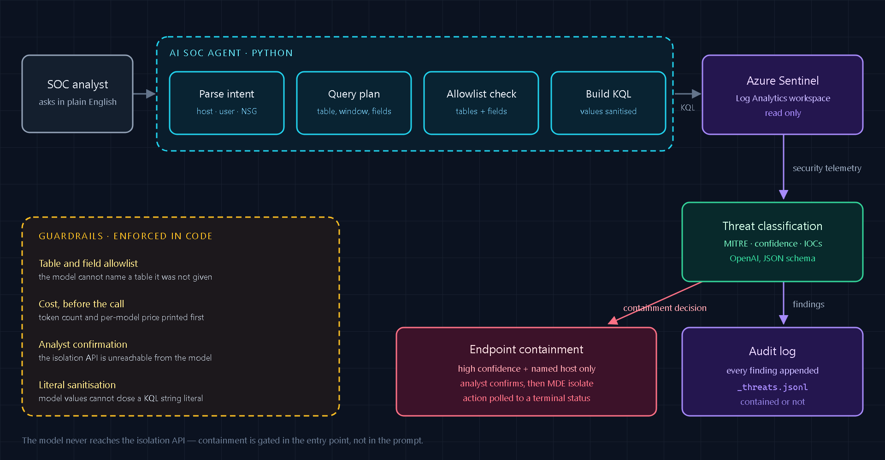
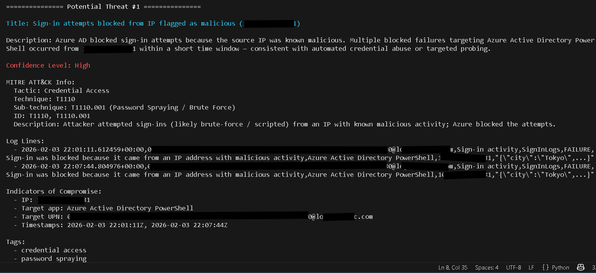
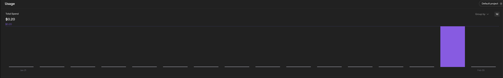
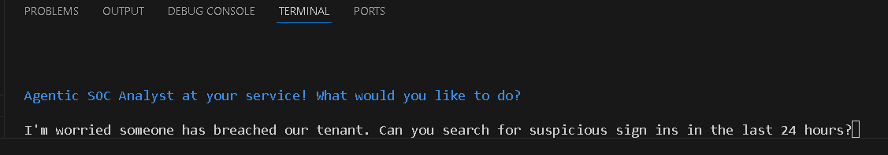
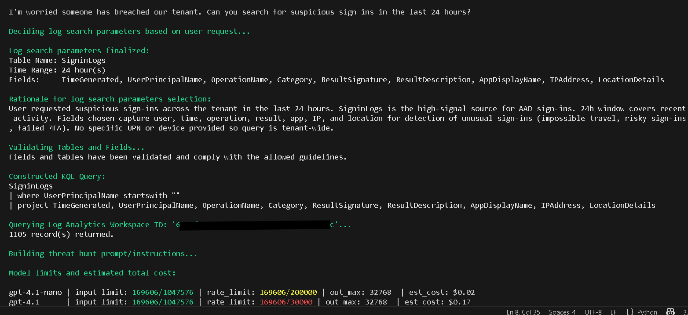
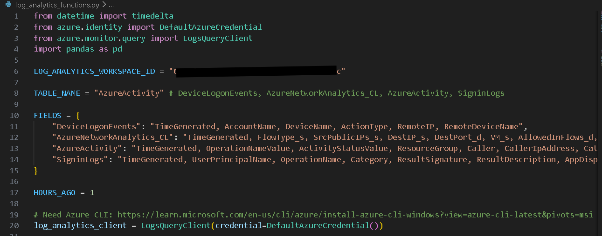
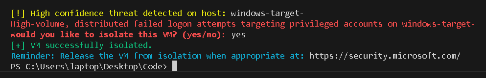
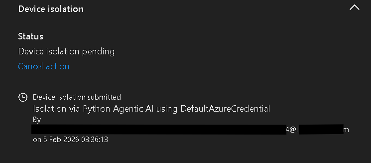

# Threat hunting and remediation with agentic AI

[](https://github.com/0xmp3/ai-soc-agent/actions/workflows/tests.yml)
[](LICENSE)

A Python agent that takes a plain-English security question, turns it into a KQL query against Microsoft Sentinel, classifies what comes back, and can isolate the affected endpoint through Microsoft Defender for Endpoint. The allowed blast radius and the API cost are both fixed before anything runs.



**Status:** runs end to end against a Sentinel + Defender for Endpoint lab tenant. 39 offline tests, green in CI. See [Status](#status) for what is missing.

Built February 2026, republished here with a cleaned commit history.

## What actually happens

`python _main.py`, then:

```
Agentic SOC Analyst at your service. What would you like to do?
I'm worried someone has breached our tenant. Can you search for suspicious sign-ins in the last 24 hours?
```

In one pass the agent:

1. **Picks the query scope.** The model is constrained to a single tool call — `query_log_analytics` — and has to return the table, time window, field list and a written rationale, plus whether the question is about a host, a user, or network security groups.
2. **Validates the scope against an allowlist** before a query string exists.
3. **Builds the KQL** and runs it against Log Analytics, reading the results into a pandas frame.
4. **Prices the analysis before paying for it.** The log payload is tokenised and a per-model cost table is printed; an unsuitable model is refused.
5. **Sends the logs to the model** under a SOC-analyst system prompt, with a JSON schema covering title, description, MITRE tactic/technique/sub-technique, confidence, IOCs, tags and recommendations.
6. **Prints the findings**, confidence-coloured, and appends each one to `_threats.jsonl`.
7. **Offers containment** — but only when the finding is high confidence *and* the original question named a specific host. It resolves the hostname to a Defender machine ID, submits a full-isolation action, and polls that action until the platform reports a terminal status.

Step 7 is the only step that changes state on a real system, and it will not proceed without a `y` at the prompt.



## The four guardrails

This is the part worth reading. An agent with a query language and an isolation API is an agent that can do damage, so each capability is bounded separately.

**The model cannot invent a table or a field.** [`GUARDRAILS.py`](GUARDRAILS.py) holds a literal allowlist of ten Sentinel tables and the fields exposed from each. `validate_tables_and_fields()` exits before the query is built if the model asks for anything outside it. The model proposes; the allowlist disposes.

**The model cannot run up a bill.** Every model in `ALLOWED_MODELS` carries its context limit, rate limit and per-million input/output price. [`MODEL_MANAGEMENT.py`](MODEL_MANAGEMENT.py) counts the real token count of the log payload with `tiktoken`, prints what each permitted model would cost for exactly that payload, and refuses a model that is over its context or rate tier. Nothing is sent until the numbers are on screen.

**Nothing gets isolated without a human.** The confirmation prompt is in [`_main.py`](_main.py), not in the model's instructions — the model has no path to the isolation API. Submission and confirmation are also kept separate: a 200 from the isolate endpoint only means Defender accepted the request, so the agent polls the action until it settles and reports the status it saw.

**Model-supplied values cannot rewrite the query.** `UTILITIES.sanitize_literal()` strips `"`, `\`, `|`, `;` and newlines out of any value before it is interpolated into a KQL string literal, so a hallucinated device name cannot close the literal or splice a new line onto the query.

## Measured cost

Not estimates dressed as results — these are read off the OpenAI usage dashboard and the agent's own pre-call output.

| | |
|---|---|
| Total API spend for the whole project | **$0.20** (usage dashboard) |
| Largest single investigation during the build | **≈ $0.08** |
| One investigation over 1,105 sign-in records | **$0.02** on `gpt-4.1-nano`, **$0.17** on `gpt-4.1` — the agent's own estimate for that payload |



## Why not just use Copilot for Security?

Because the point was to bound the cost and the blast radius myself, in code I can read. Copilot for Security is licensed against a consumption unit you buy in advance; this runs about two cents an investigation on a pay-as-you-go key, and every limit that stops it doing something stupid is a line in `GUARDRAILS.py` rather than a setting in a portal. That trade — less coverage, fully inspectable guarantees — is the whole design. It is not a replacement for a licensed product and does not try to be.

## Run it

```bash
git clone https://github.com/0xmp3/ai-soc-agent.git
cd ai-soc-agent
./setup.sh          # .\setup.ps1 on Windows
source venv/bin/activate
```

```bash
cp _keys.example.py _keys.py    # OPENAI_API_KEY + LOG_ANALYTICS_WORKSPACE_ID
az login                        # the agent authenticates with DefaultAzureCredential
python _main.py
```

You need a tenant with Sentinel and Defender for Endpoint, permission to query the workspace, and permission to submit machine actions. Both settings also work as environment variables if you would rather not keep a secrets file; `_keys.py` is git-ignored either way.

## Tests

39 tests, no Azure tenant or OpenAI key required — the guardrail logic is pure, so it can be exercised offline.

```bash
pip install -r requirements.txt pytest
python -m pytest -q
```

They cover the allowlist (known table accepted, unknown table and unknown field both refused, a field exposed by one table rejected on another), the cost guardrail (arithmetic against the published per-million prices, over-context and over-tier detection, fallback to the default model), sanitisation (quotes, backslashes, newlines and semicolons stripped; ordinary values untouched), and the generated KQL itself — including four model-supplied injection payloads that must not splice a new line onto the query.

What they do not cover, because it needs a live tenant: the Log Analytics round trip, the model's actual query choice, and the Defender isolation call. Those are verified by the walkthrough below.

## Status

| | |
|---|---|
| Works | NL → table/field/time-range selection, allowlist validation, KQL execution, token counting, cost table and model refusal, schema-constrained findings, MITRE mapping, JSONL audit log, host isolation with action polling |
| Works | 39 offline tests, CI on every push — the allowlist, cost, sanitisation and KQL-construction logic |
| Missing | Pagination and retry on Log Analytics; a single query runs to the workspace's row limit |
| Stub | The `about_individual_user` and `about_network_security_group` branches are placeholders — only host isolation is implemented |
| Not built | Multi-workspace and multi-tenant; scheduled or autonomous hunts |
| Not production | One analyst's assistant, run by hand, with a human on every confirmation prompt |

## Walkthrough

| | |
|---|---|
|  | **Ask.** The whole interface is a prompt. |
|  | **Plan and price.** Table, window and fields chosen with a rationale, allowlist check, KQL generated, then the per-model cost table. The two red rows are over the rate tier and are refused. |
|  | **The query**, printed before it executes. |
|  | **Contain.** High confidence on a named host triggers the confirmation prompt, not an action. |
|  | **Confirm.** Defender reports the action as pending, which is what "submitted" actually looks like. |
|  | **Audit.** Every finding is appended to `_threats.jsonl` whether or not anything is contained. |

## Files

```
_main.py              entry point - the workflow, the confirmation prompt, config
conftest.py           puts the top-level modules on sys.path for pytest
EXECUTOR.py           model tool-call, KQL construction, Log Analytics query, MDE isolation
GUARDRAILS.py         table/field allowlist, model allowlist with limits and prices
MODEL_MANAGEMENT.py   token counting, cost estimation, model selection
PROMPT_MANAGEMENT.py  system prompts, per-table analyst instructions, tool schema
UTILITIES.py          output formatting, query sanitisation, JSONL audit log
_keys.example.py      config template - copy to _keys.py
tests/                39 tests - guardrails, costs, sanitisation, KQL construction
docs/                 architecture diagram and the written report
.github/workflows/    CI - installs requirements, runs pytest
```

## Write-up

[`docs/threat-hunting-with-agentic-ai.pdf`](docs/threat-hunting-with-agentic-ai.pdf) — 21 pages covering the build process, the lab environment, and the results behind the cost figures above.

## Licence

MIT — see [LICENSE](LICENSE).
